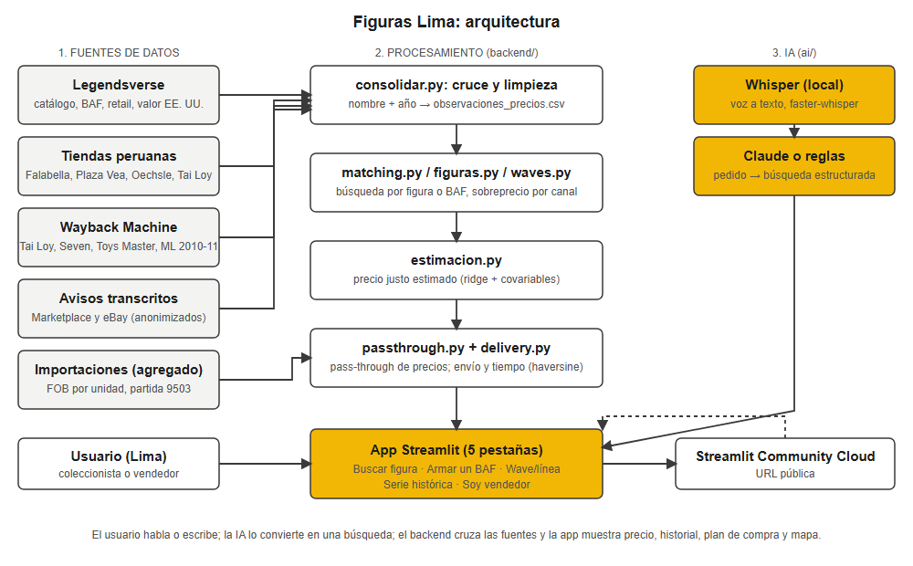

# Figuras Lima

## 1. One-liner
Ayudamos a coleccionistas de Marvel Legends en Lima a completar sus Build-A-Figures pieza por pieza, con precio total y tiempo de entrega, mediante búsqueda por voz o texto con IA.

## 2. Founder
Coleccionista de Marvel Legends en Lima, comprador y observador del mercado de reventa desde adentro. Conozco el problema como comprador (buscar una figura o la pieza de BAF que falta, comparar precios en grupos y negociar uno a uno) y, por un vendedor conocido, como oferente (no sabe cuánto cobrar ni a quién le interesa su stock). Producto, ingeniería, diseño y análisis de datos los cubro con agentes de IA (Claude Code); yo defino el problema, valido los datos con compradores y vendedores y reviso cada parte.
> **TODO (Angelo):** nombre y foto.

## 3. Problema
Hoy los coleccionistas de Lima buscan figuras en grupos de Facebook, WhatsApp y tiendas sueltas: no hay catálogo único, los precios no son comparables y no se sabe cuánto cuesta ni cuánto demora el envío hasta que se negocia.
Cómo lo resuelven hoy: scroll en grupos, mensajes uno a uno, WhatsApp.

**Evidencia de usuarios** (en [`docs/research/`](docs/research/)):
- Entrevista 1 (coleccionista): compra sobre todo figuras del UCM; paga hoy unos S/ 110 por una figura regular en caja; el precio suelto depende de qué tan conocido es el personaje, su calidad y su escasez; extrañó las waves con buena BAF. [Notas](docs/research/entrevista_01_coleccionista.md).
- Entrevista 2 (vendedor que importa): 50% de sus ventas son Legends y 30% S.H. Figuarts; no tiene relación con las productoras (importa por su cuenta) y le gustaría ser franquicia de Hasbro. Aceptaría exclusividad a cambio de un descuento que le deje vender a unos S/ 90 (precio pre pandemia) y dice que la demanda ha caído. Ante un alza pequeña y permanente vendería unos 3/4 de su volumen actual. [Notas](docs/research/entrevista_02_vendedor.md).
- Entrevista 3: pendiente (otro coleccionista, idealmente de otro perfil).
Con dos entrevistas el problema sigue siendo en parte hipótesis; falta la tercera.

## 4. Solución e insight
El coleccionista dice lo que quiere ("Goku Ultra Instinto nuevo, hasta 300 soles, vivo en Miraflores"). El sistema lo convierte en una búsqueda estructurada, rankea avisos de vendedores y calcula el costo y tiempo de entrega con repartidores independientes.
**Insight:** el coleccionista de Marvel Legends no es muy sensible al precio ni tiene un sustituto cercano entre las marcas premium. Si faltara la línea, el reemplazo sería Marvel Select, no Hot Toys, Mafex ni S.H. Figuarts, y un alza de 1% no cambiaría su compra (entrevista 1). Lo que sí cambia su decisión es encontrar la figura o la pieza de BAF que busca, a un precio que pueda comparar. Ese precio hoy es opaco: en nuestras observaciones el precio de reventa en Lima ronda +24% sobre el retail oficial (mediana en Marketplace), con mucha dispersión entre vendedores y canales. El valor no está en abaratar la figura sino en **encontrarla y emparejar a quien la busca con quien la vende**.

## 5. Why now
Whisper corre local y barato en una laptop; los LLM extraen datos estructurados de lenguaje natural con pocas líneas; hace tres años esto requería entrenar modelos propios.

## 6. Demo
```bash
pip install -r requirements.txt
python data/scrape_legendsverse.py  # opcional: vuelve a bajar el catálogo (3 s entre peticiones)
python data/make_listings.py        # regenera los avisos sintéticos de Lima
streamlit run app/streamlit_app.py
```
- URL pública: https://trabafinal-h69ccv3efrkmbcl7ntxvhf.streamlit.app/ (Streamlit Community Cloud; sin `ANTHROPIC_API_KEY` usa el parser por reglas)
- Diagrama de arquitectura: [`docs/arquitectura.svg`](docs/arquitectura.svg)



- Capturas de la app pública:
  1. [Buscar figura: precio justo, historial y tiendas](docs/img/captura_1_buscar_figura.png)
  2. [Armar un BAF: plan de compra y mapa](docs/img/captura_2_armar_baf.png)
  3. [Serie histórica: cobertura y pass-through](docs/img/captura_3_serie_historica.png)
- Modelos: Whisper `small` vía faster-whisper, local, porque los audios del usuario no deben salir de su equipo. Claude (`claude-haiku-5-5`) con tool use para extraer la búsqueda; si no hay `ANTHROPIC_API_KEY` se usa un parser por reglas offline.

```
voz/texto → [Whisper local] → [Claude o reglas → Busqueda] → matching (rapidfuzz) → envío (haversine) → tabla + mapa Folium
```

**Datos:**
- **Catálogo real:** 92 BAF y 631 piezas de Marvel Legends (2005–2025) desde [Legendsverse](https://legendsverse.com): qué figura trae cada pieza, imagen de la pieza y valor de mercado en USD (ventas en eBay). Scraper de bajo volumen: `data/scrape_legendsverse.py`.
- **Retail por año:** `data/retail_por_anio.csv`, de la guía de precios de Legendsverse (2012+).
- **Waves y figuras sin BAF:** 172 waves y 1,692 figuras con valor de mercado (`data/scrape_legendsverse_figuras.py`, `data/scrape_legendsverse_waves.py`).
- **Avisos reales:** `data/listings_reales.csv`, transcritos a mano de capturas de Facebook Marketplace, eBay y la tienda Tai Loy (vendedores anonimizados). Los de Lima con pieza de BAF alimentan el plan; los de eBay se muestran como alternativa de importación (sin aranceles).
- **Avisos simulados** (`data/make_listings.py`): relleno sintético sobre figuras reales donde no hay avisos reales. La app los rotula «simulado».
- **Retail histórico por figura:** `data/marvel_legends_retail_historico.csv`, 1,692 empaques (1997–2027) con retail oficial, año y valor de mercado.
- **Tiendas peruanas:** `data/scrape_tiendas_pe.py` → Falabella, Plaza Vea/Oechsle (con EAN) y Tai Loy; `data/cruce_mercado.py` las cruza con el retail y calcula el sobreprecio.
- **Importaciones (Veritrade, partida 9503):** solo el agregado `data/importaciones_ml_resumen.csv`; identificables hasta línea y surtido, no por figura. Los archivos de Veritrade (licencia paga) no van al repo.
- Detalle de fuentes, permisos y bloqueos (Facebook, Mercado Libre, Ripley): [`docs/fuentes_de_datos.md`](docs/fuentes_de_datos.md).

## 7. Modelo de negocio
**Plataforma de dos lados:** conectamos vendedores con compradores emparejando las preferencias de figuras de un lado (qué busca cada coleccionista, incluidas piezas de BAF) con la oferta del otro.
- **Vendedor:** comisión por cada venta cerrada dentro de la plataforma.
- **Comprador:** modelo freemium. Gratis al inicio (búsqueda y alertas básicas); al crecer el número de envíos, membresía mensual por búsquedas ilimitadas y alertas de emparejamiento.
- **Por qué dos lados:** la comisión paga la intermediación y el cobro al comprador financia las alertas y el matching, que es lo que cuesta (IA y servidor).

> **Supuestos de precio a validar con la entrevista 3 y más vendedores (no medidos):** comisión del vendedor 8% de la venta; membresía del comprador S/ 9.90 al mes tras el período gratis. Falta calcular el costo por usuario (tokens, servidor) y comprobar si el vendedor aceptaría esa comisión (no se la preguntamos al vendedor en la entrevista 2).

**Efecto de doble marginalización (sobreprecio de reventa):** `(Precio_rev − P_retail) / P_retail`, con P_retail = retail de Hasbro en USD × tipo de cambio. El vendedor ve cómo se separa del retail y del mercado (`backend/pricing.py`, pestaña *Soy vendedor*).
Supuestos de envío del modelo (a validar con repartidores): S/ 6 base + S/ 1.2 por km, ~15 km/h (`backend/delivery.py`).

## 8. Herramientas del curso
| Herramienta | Dónde |
|---|---|
| Voz a texto con Whisper (sesión 13) | [`ai/transcribe.py`](ai/transcribe.py) |
| LLM con salidas estructuradas (sesión 8) | [`ai/parser.py`](ai/parser.py) |
| Mapas con Folium (sesión 6) | [`app/streamlit_app.py`](app/streamlit_app.py) |

## 9. Qué hizo el agente
Claude Code generó el esqueleto del repo, el generador de datos sintéticos, el motor de matching, el parser y la app Streamlit, en sesiones con el founder, que definió el problema y el flujo y revisa cada parte.
> **TODO:** actualizar al final con detalle honesto.
